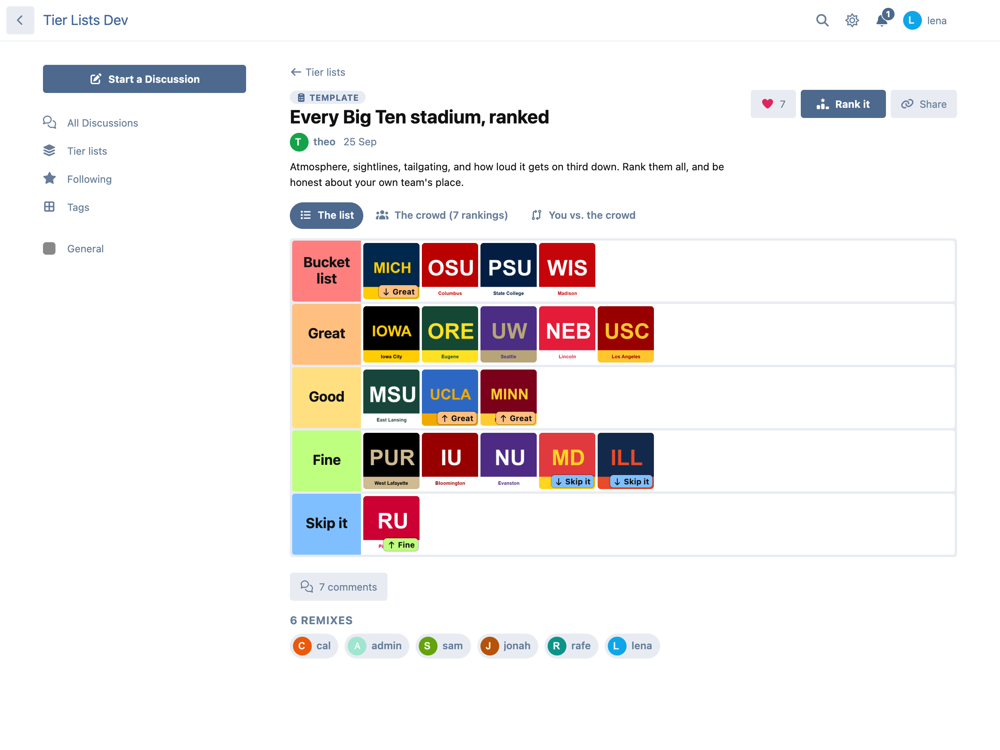
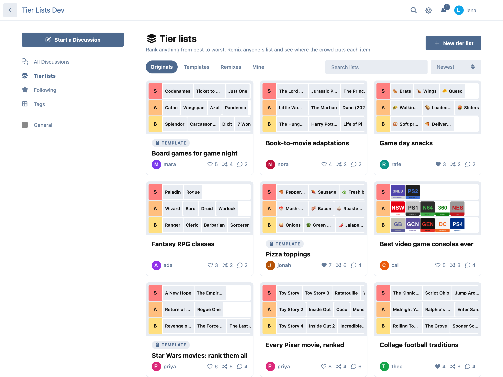
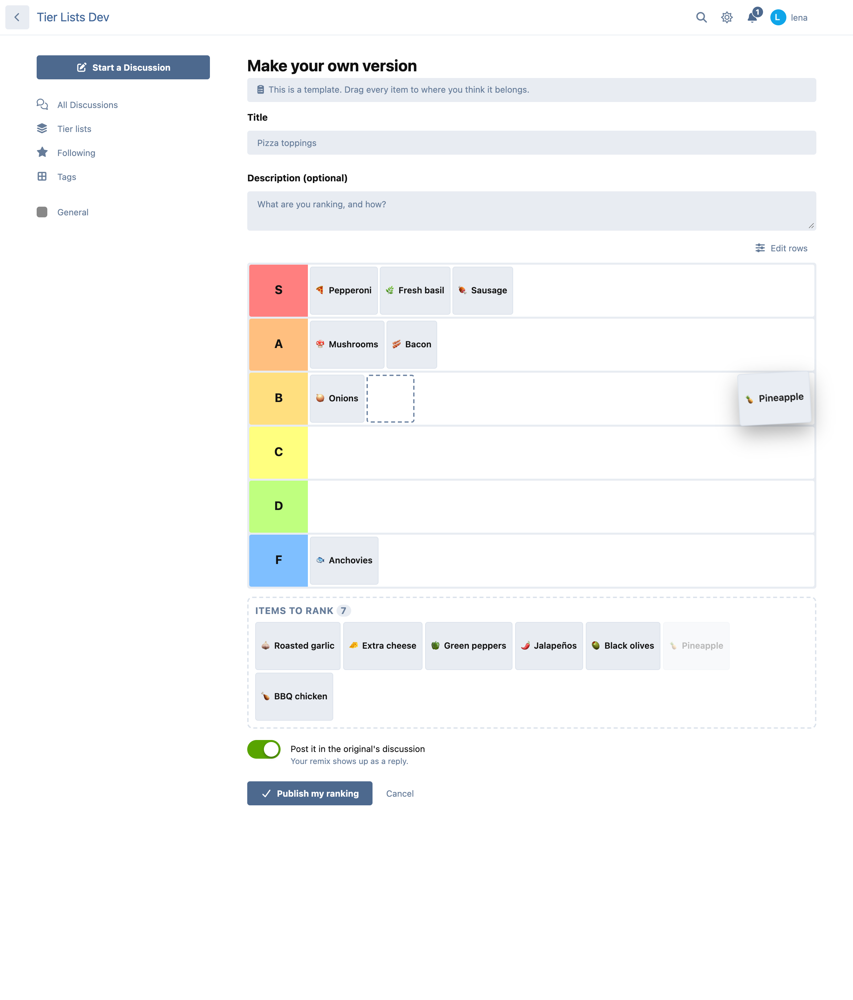
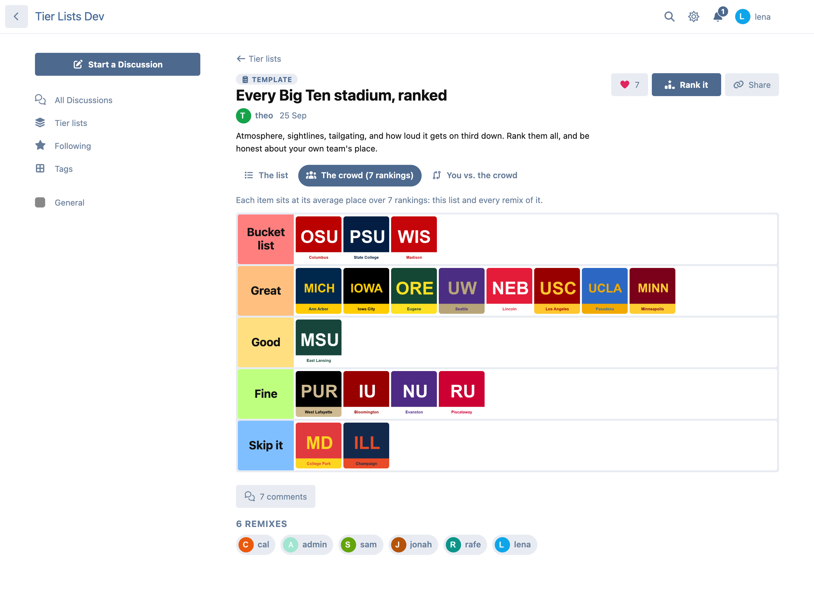
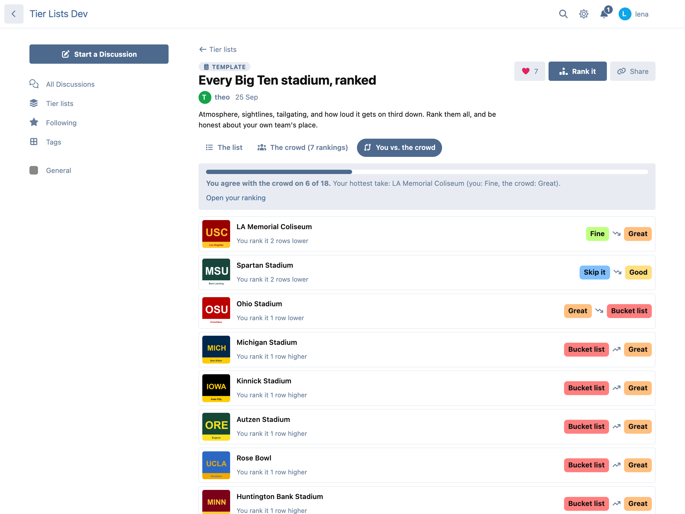
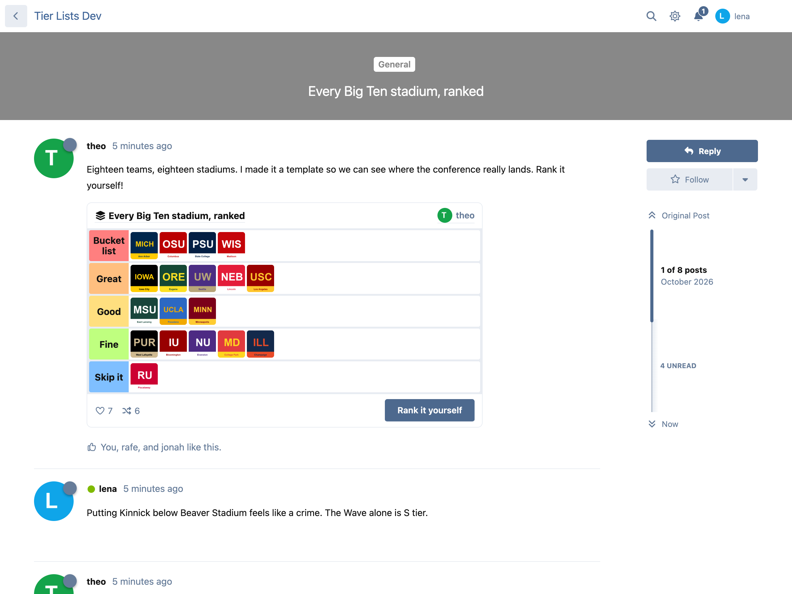
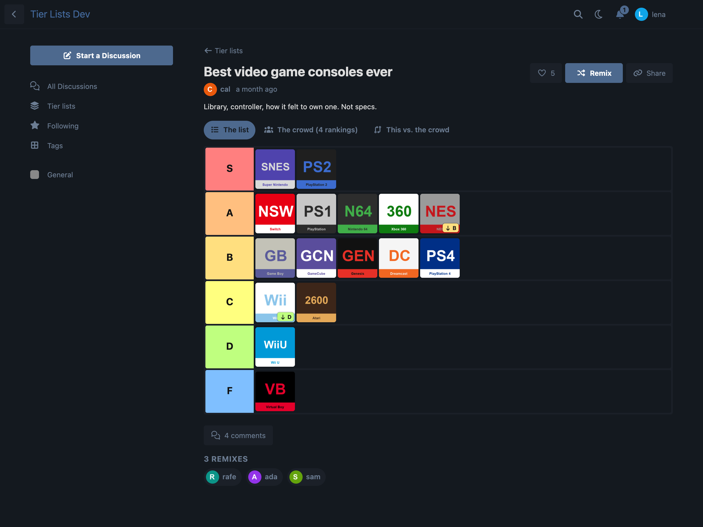

# Tier Lists

Rank anything from S to F, remix each other's lists, and see where the crowd puts every item. For Flarum 2.

 [](https://packagist.org/packages/ernestdefoe/tier-lists)



- **Make a list in seconds.** Give it a title, type items (or paste a whole list, one per line), add pictures, and drag everything into rows. Rows start as S, A, B, C, D and F; rename them, recolor them, reorder them, or use 2 to 10 of your own.
- **Drag and drop that works everywhere.** Mouse, pen and touch (hold an item, then drag; a quick swipe still scrolls). On a phone, the items left to rank stay docked at the bottom of the screen. Tap an item for a menu with a button for each row.
- **Keyboard and screen readers.** Space picks an item up, the arrow keys move it, Space drops it, Escape puts it back, M opens the menu. Every move is announced.
- **Remix anything.** One click copies a list into your own version to rearrange. The original then shows **the crowd's version** (every item at its average place over all remixes) and **you vs. the crowd**: where you agree, and your hottest take.
- **Templates.** Start a list as a template and everyone ranks the same fixed set of items, which makes the crowd's average a real community ranking.
- **Browse** every list at `/tierlists`: newest, most liked or most remixed, with tabs for templates, remixes and your own, and a search. Each card peeks at the top three rows. Members' profiles link to their lists.
- **Comments are a discussion.** Publishing a list can start a discussion in a tag you choose, with the list at the top. A remix can post itself as a reply there.
- **Embed in any post.** Paste a list's link alone on a line and it shows up as the board. Works with every editor; if the extension is ever turned off, it's just a link again.
- **Likes and notifications.** Members get an alert when someone likes or remixes their list (and an email for remixes, if they want one).
- **Pictures:** uploaded with FoF Upload when it's installed, otherwise to the extension's own storage. Every upload is checked by its content and re-encoded as WebP, which strips location data. Pictures from other sites are refused, so viewing a list never sends your members' addresses anywhere else.
- **Light on your forum.** Only a small script loads on every page; the pages and the editor load when opened. The list page costs the same number of queries for 1 list or 24, and every board embedded on a page comes from one request.
- **Permissions** to view, to make/remix/like, and to moderate. Link previews (Open Graph) for every list. **GDPR** export and erasure with Flarum's GDPR extension.

## Screenshots

| | |
|---|---|
|  |  |
|  |  |
|  |  |

## Install

```sh
composer require ernestdefoe/tier-lists
```

## Update

```sh
composer update ernestdefoe/tier-lists
php flarum migrate
php flarum cache:clear
```

## Links

- [Packagist](https://packagist.org/packages/ernestdefoe/tier-lists)
- [GitHub](https://github.com/ernestdefoe/tier-lists)

☕ If this saves you time, you can [buy me a coffee](https://buymeacoffee.com/ernestdefoe).
